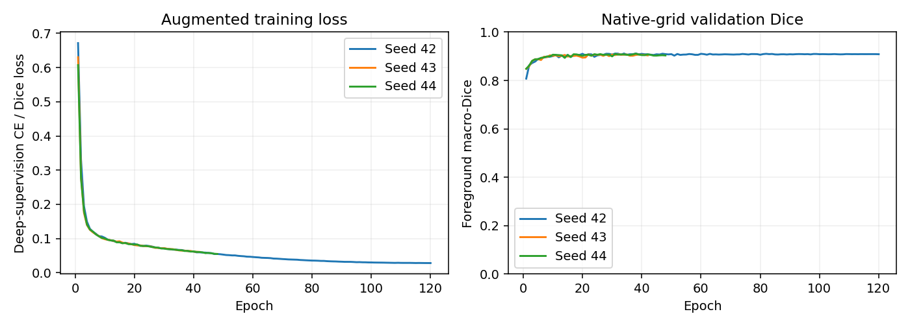

# CAMUS segmentation

A compact PyTorch project for echocardiography segmentation, with completed GPU experiments and a patient-level evaluation pipeline.

**Completed improvement:** foreground macro-Dice increased from **0.8153 to 0.9141** on the official CAMUS public release, using the publisher's unchanged 400/50/50 patient split. Validation selected an equal-probability ensemble of three enhanced U-Nets without component cleanup. The two new trials ran concurrently and stopped at **42 and 48 epochs**, each after exactly **10 consecutive epochs without validation improvement**; the already completed seed 42 checkpoint was reused. All **32 tests**, concurrent CUDA training, and standalone native-grid inference checks passed.

| Test metric | Original baseline | Improved ensemble [95% patient-bootstrap CI] |
| --- | --- | --- |
| Foreground macro-Dice | 0.8153 | **0.9141 [0.9071, 0.9202]** |
| Foreground macro-IoU | 0.7052 | 0.8456 [0.8348, 0.8552] |
| HD95 | 20.22 mm | **4.06 mm [3.67, 4.56]** |
| ASSD | 4.48 mm | 1.46 mm [1.36, 1.58] |

The paired Dice gain is **0.0988 [0.0851, 0.1155]**, or 9.88 percentage points. **This is a development follow-up on the same 50 test patients / 200 frames whose baseline results were already inspected, not a fresh independent confirmation.** All new checkpoint, ensemble and cleanup selection used validation patients only; the frozen winner was evaluated once. Remaining failure cases include boundary displacement and atrial errors. See the [complete comparison, validation candidates and failure gallery](results/camus-v3/README.md), [original baseline](results/camus-seed42/README.md), and [verification record](docs/verification.md).



## What this repo does

- Segments left-ventricular cavity, myocardium, and left atrium at end-diastole (ED) and end-systole (ES) in 2CH and 4CH views.
- Keeps all four frames from each patient in the same partition; checks duplicate pixels across partitions and binds checkpoints to hashed manifests and splits.
- Reports native-grid Dice, IoU, HD95 and average symmetric surface distance (ASSD) in millimetres, with patient-bootstrap confidence intervals.
- Saves per-frame and per-patient metrics, view/phase/image-quality subgroups, an all-background reference, and a gallery of the worst cases.

This is a research implementation for learning and reproducible experimentation. It has no clinical validation and does not estimate ejection fraction or make diagnoses.

## Quick start

The GPU run uses Python 3.9.18 in WSL; CI uses Python 3.12. From the repository root:

```bash
python -m venv .venv
source .venv/bin/activate
# Windows PowerShell: .\.venv\Scripts\Activate.ps1
python -m pip install torch==2.7.1 --index-url https://download.pytorch.org/whl/cpu
python -m pip install -r requirements-tested.txt
python -m pip install -e . --no-deps
python -m pytest -q
python -m camus_seg.cli demo --out runs/synthetic-demo
```

The demo trains a very small U-Net for up to 20 epochs on geometric fixtures from 12 synthetic IDs (8 train / 2 validation / 2 test), with patience 10. The verified demo stopped at epoch 19, retaining epoch 9. These shapes are **not ultrasound images**. Any metrics in its report are software-check outputs, not evidence of medical performance. Use a new output directory for every run; commands refuse to overwrite existing experiment directories.

The direct dependency versions used for verification are in `requirements-tested.txt`; it is not a complete transitive lockfile. CUDA training requires a compatible PyTorch installation. For deterministic CUDA operations, launch with the PyTorch-recommended `CUBLAS_WORKSPACE_CONFIG=:4096:8`; reproducibility across hardware and library versions is not guaranteed.

## Run with CAMUS

Obtain a labelled release from the [official CAMUS deposit](https://humanheart-project.creatis.insa-lyon.fr/database/#collection/6373703d73e9f0047faa1bc8) and review its usage terms. The helper below downloads just the annotated ED/ES frames and metadata, including the publisher's split files. Dataset files and weights are excluded from this repo. The code license does not license CAMUS data or derived models; the source uses CC BY-NC-SA 4.0 and permits non-commercial scientific research.

The importer supports paired `patientXXXX_2CH_ED.nii.gz` / `patientXXXX_2CH_ED_gt.nii.gz` files, or `.mhd` files with their referenced pixel files. It expects four labelled frames per included patient and optional `Info_2CH.cfg` / `Info_4CH.cfg` metadata. It accepts 2D arrays or singleton-z frames, validates matching image/mask physical grids, and retains the original spacing. It does not import annotated sequences.

```bash
python scripts/download_camus.py --out data/raw --workers 6
python -m camus_seg.cli prepare --raw data/raw/database_nifti --out data/prepared --source-tag "CAMUS_public official ED/ES NIfTI release; collection 6373703d73e9f0047faa1bc8; download_manifest.json retained in data/raw"
python -m camus_seg.cli split --manifest data/prepared/manifest.json --out data/split.json --official-dir data/raw/database_split
```

The commands above require CUDA-enabled PyTorch. For CUDA 12.6, install `torch==2.7.1` from `https://download.pytorch.org/whl/cu126` (use `--force-reinstall` if replacing the CPU wheel). Before launching Python, set `CUBLAS_WORKSPACE_CONFIG=:4096:8`: Bash `export CUBLAS_WORKSPACE_CONFIG=:4096:8`; PowerShell `$env:CUBLAS_WORKSPACE_CONFIG=":4096:8"`. The completed run used WSL, Python 3.9.18, and an RTX 4050 Laptop GPU. Exact versions are in [environment-wsl.json](docs/environment-wsl.json).

Confirm the release's label map before running: `0` background, `1` LV cavity, `2` myocardium, `3` left atrium. Non-integer and unknown labels fail validation; numeric validation alone cannot detect a semantically swapped label map. Visual inspection of the imported reference masks is essential.

`--official-dir` preserves the publisher's corrected public split: 400 training, 50 validation and 50 testing patients. Its accompanying information file notes corrections relative to the article. Membership is read from the actual files, never inferred from patient number ranges. Omitting this argument creates a custom 70/15/15 split for other experiments and synthetic checks. Neither mode reproduces the paper's complete cross-validation study. Old distributions can reuse IDs; indexing merged releases fails on duplicate patient/view/phase keys. Do not flatten or relabel them to bypass that guard.

Freeze the split before training. Choose epochs and settings on validation data, then run the test evaluation once. Repeat training with predeclared seeds on the same split to study optimization variability; do not select a seed using the test score. See [the evaluation protocol](docs/evaluation.md) for estimands, exclusions, and limitations.

## Improved experiment and runtime policy

Both trainers default to `patience=10`, `min_delta=0`: a strict gain in native-grid validation Dice resets the counter; the tenth consecutive non-improving epoch ends that trial and retains its best checkpoint. [AGENTS.md](AGENTS.md) records this policy for future work. Best checkpoints are saved atomically.

The completed follow-up used two independent CUDA training processes on one RTX 4050, a shared prepared CPU tensor cache, and up to 20 CPU threads for preprocessing and validation distance metrics. GPU utilization reached 100%, with approximately 3 GB occupied by the two trials. Concurrency is limited by available VRAM with a reserve; one physical GPU does not imply a twofold training speedup. Early stopping reduced the two new trials from a combined maximum of 240 epochs to 90.

With the existing local data and inherited checkpoint, the completed orchestration was:

```bash
export CUBLAS_WORKSPACE_CONFIG=:4096:8
python -m camus_seg.parallel_improve \
  --manifest data/prepared/manifest.json --split data/split.json \
  --plan docs/improvement-plan-v3.json \
  --baseline-patients results/camus-seed42/patient_metrics.json \
  --inherited runs/improvement-v2/seed42 --out runs/improvement-v3
```

The output directory must be new. This command deliberately requires the completed inherited seed 42 checkpoint; weights are retained locally and excluded from Git. See [reproduction details](docs/reproduction.md) for the historical source versions and training-only reconstruction. The original scheduler was stopped at the user's request before any new test evaluation. Seed 42 had just completed 120 epochs; its best checkpoint (epoch 34) was kept. The interrupted one-epoch seed 43 attempt was excluded and replaced. All interruption and stopping records are in the [result bundle](results/camus-v3/README.md).

For inference with the locally retained frozen ensemble:

```bash
python scripts/predict_improved.py --run runs/improvement-v3 \
  --image data/raw/database_nifti/patient0001/patient0001_2CH_ED.nii.gz \
  --out runs/predictions/patient0001_2CH_ED.nii.gz --device cuda
```

This writes a research segmentation mask on the original image grid, preserving spacing, origin and direction, plus input/output/checkpoint hashes and the label map. Use `--device cpu` when CUDA is unavailable.

## Outputs

| Artifact | Contents |
| --- | --- |
| `manifest.json` | Release tag, frame IDs, source paths and hashes, prepared-file hashes |
| `split.json` | Exact patient membership, seed, manifest hash |
| `provenance.json` | Settings, package versions, code hash, fitting/selection IDs |
| `history.json`, `best.pt` | Epoch losses, validation Dice, best validation checkpoint |
| `training_status.json` | Actual epochs, best epoch, stopping counter and stop reason |
| `selected_config.json`, `validation_selection.json` | Frozen inference choice and every validation candidate |
| `report.json` | Model and background summaries, subgroup sizes, CIs and failure counts |
| `frame_metrics.csv`, `patient_metrics.json` | Auditable individual results |
| `worst_cases.png` | Four lowest frame-level macro-Dice examples, shown without cherry-picking |

An example software-check report is in [examples/synthetic](examples/synthetic/README.md). [Verification notes](docs/verification.md) record the completed checks and study limits.

`scripts/report_run.py` packages the legacy baseline; `scripts/report_improvement.py` packages the follow-up with all three histories, paired confidence intervals, runtime records and checksums. They verify checkpoint and data identities. Weights stay in the local `runs/` directory; the public repo includes the result records and reproduction code.

## Design and limits

The enhanced model has five levels / four downsamplings, base width 16, instance normalization, LeakyReLU, transposed-convolution upsampling and four-scale deep supervision. Aspect-preserving 256-square letterboxing, paired affine augmentation, AdamW, cosine scheduling, gradient clipping and mixed-precision convolution are used. All loss reductions use float32. The selected inference averages three models' native-grid probabilities and applies no component cleanup. No pretrained weights were used. This bundled comparison does not isolate the contribution of each change.

The preserved original baseline uses a three-level U-Net, Adam, equal cross-entropy / foreground soft-Dice losses, square resizing, and no augmentation or postprocessing. Both methods clip/scale each image using its own 1st/99th percentiles, avoiding normalization fitted across test patients. Labels use nearest-neighbour interpolation; logits return to the original grid before scoring. The legacy `camus_seg.cli train` entry point still trains this smaller baseline; the improved model uses the parallel command above.

Quality subgroups are descriptive, may be small, and are not a fairness or clinical validation study. Exact duplicate checks do not detect near duplicates or incorrect patient identifiers. The available CAMUS manual references are observer-dependent; source quality, acquisition site and device constrain generalization. In contrast to the original paper's main good/medium-quality evaluation, this baseline includes all labelled qualities and reports subgroups. Differences in release, architecture and evaluation conventions prevent a direct leaderboard comparison.

## Sources

- Leclerc et al., *Deep Learning for Segmentation Using an Open Large-Scale Dataset in 2D Echocardiography*, IEEE TMI 38(9), 2198–2210, 2019. [DOI: 10.1109/TMI.2019.2900516](https://doi.org/10.1109/TMI.2019.2900516). Cite this work when using CAMUS.
- [Official dataset description](https://www.creatis.insa-lyon.fr/Challenge/camus/databases.html) and [manual reference protocol](https://www.creatis.insa-lyon.fr/Challenge/camus/evaluation.html).
- [U-Net paper](https://arxiv.org/abs/1505.04597), Ronneberger et al., 2015; this repo uses a smaller implementation, not the original architecture.
- [Kjelsrud et al., *Lightweight image segmentation for echocardiography*](https://arxiv.org/abs/2509.03631), which informed the stronger training recipe; this implementation is not a replication or a state-of-the-art claim.
- [SimpleITK image conventions](https://simpleitk.org/SimpleITK-Notebooks/01_Image_Basics.html), [SciPy physical distance transforms](https://docs.scipy.org/doc/scipy/reference/generated/scipy.ndimage.distance_transform_edt.html), and [PyTorch reproducibility guidance](https://docs.pytorch.org/docs/stable/notes/randomness.html).

Code: [MIT](LICENSE). CAMUS-derived failure figures: [CC BY-NC-SA 4.0 and source terms](results/camus-v3/DATA_LICENSE.md). Raw data and weights are obtained/generated separately.
