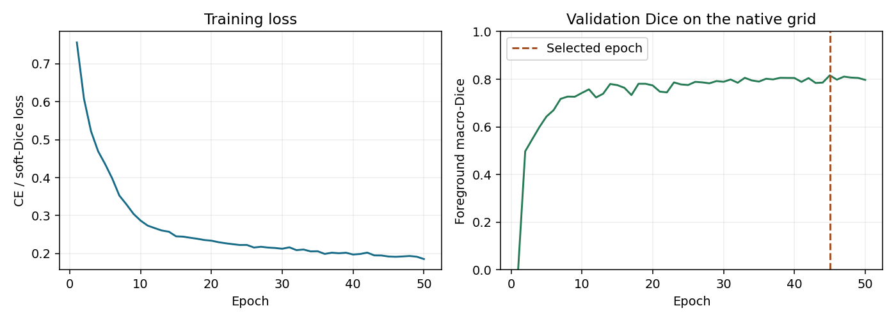

# CAMUS segmentation

A compact PyTorch U-Net baseline for echocardiography segmentation, with a reproducible patient-level evaluation pipeline.

**Completed:** a 50-epoch GPU run on the official CAMUS public release, using the publisher's 400/50/50 patient split. The checkpoint selected on validation data (epoch 45) was evaluated once on 50 held-out patients / 200 frames. All **19 tests** and a separate CUDA training/checkpoint/evaluation smoke check passed.

| Test metric | Patient mean | 95% patient-bootstrap CI |
| --- | --- | --- |
| Foreground macro-Dice | **0.8153** | 0.7953–0.8324 |
| Foreground macro-IoU | 0.7052 | 0.6821–0.7258 |
| HD95 | 20.22 mm | 18.28–22.25 mm |
| ASSD | 4.48 mm | 4.07–4.96 mm |

The boundary errors remain substantial. The automatically selected failure gallery shows fragmented masks, misplaced atrial regions, and false-positive islands. This is a completed compact research baseline, not a clinically validated model. See the [full results, per-structure scores and failure cases](results/camus-seed42/README.md), [frozen run plan](results/camus-seed42/run-plan.json), and [verification record](docs/verification.md).



## What this repo does

- Segments left-ventricular cavity, myocardium, and left atrium at end-diastole (ED) and end-systole (ES) in 2CH and 4CH views.
- Keeps all four frames from each patient in the same partition; checks duplicate pixels across partitions and binds checkpoints to hashed manifests and splits.
- Reports native-grid Dice, IoU, HD95 and average symmetric surface distance (ASSD) in millimetres, with patient-bootstrap confidence intervals.
- Saves per-frame and per-patient metrics, view/phase/image-quality subgroups, an all-background reference, and a gallery of the worst cases.

This is a research implementation for learning and reproducible experimentation. It has no clinical validation and does not estimate ejection fraction or make diagnoses.

## Quick start

The GPU run uses Python 3.9.18 in WSL; CI uses Python 3.12. From the repository root:

```bash
python -m venv .venv
source .venv/bin/activate
# Windows PowerShell: .\.venv\Scripts\Activate.ps1
python -m pip install torch==2.7.1 --index-url https://download.pytorch.org/whl/cpu
python -m pip install -r requirements-tested.txt
python -m pip install -e . --no-deps
python -m pytest -q
python -m camus_seg.cli demo --out runs/synthetic-demo
```

The demo trains a very small U-Net for 20 epochs on geometric fixtures from 12 synthetic IDs (8 train / 2 validation / 2 test). These shapes are **not ultrasound images**. Any metrics in its report are software-check outputs, not evidence of medical performance. Use a new output directory for every run; commands refuse to overwrite existing experiment directories.

The direct dependency versions used for verification are in `requirements-tested.txt`; it is not a complete transitive lockfile. CUDA training requires a compatible PyTorch installation. For deterministic CUDA operations, launch with the PyTorch-recommended `CUBLAS_WORKSPACE_CONFIG=:4096:8`; reproducibility across hardware and library versions is not guaranteed.

## Run with CAMUS

Obtain a labelled release from the [official CAMUS deposit](https://humanheart-project.creatis.insa-lyon.fr/database/#collection/6373703d73e9f0047faa1bc8) and review its usage terms. The helper below downloads just the annotated ED/ES frames and metadata, including the publisher's split files. Dataset files and weights are excluded from this repo. The code license does not license CAMUS data or derived models; the source uses CC BY-NC-SA 4.0 and permits non-commercial scientific research.

The importer supports paired `patientXXXX_2CH_ED.nii.gz` / `patientXXXX_2CH_ED_gt.nii.gz` files, or `.mhd` files with their referenced pixel files. It expects four labelled frames per included patient and optional `Info_2CH.cfg` / `Info_4CH.cfg` metadata. It accepts 2D arrays or singleton-z frames, validates matching image/mask physical grids, and retains the original spacing. It does not import annotated sequences.

```bash
python scripts/download_camus.py --out data/raw --workers 6
python -m camus_seg.cli prepare --raw data/raw/database_nifti --out data/prepared --source-tag "CAMUS_public official ED/ES NIfTI release; collection 6373703d73e9f0047faa1bc8; download_manifest.json retained in data/raw"
python -m camus_seg.cli split --manifest data/prepared/manifest.json --out data/split.json --official-dir data/raw/database_split
python -m camus_seg.cli train --manifest data/prepared/manifest.json --split data/split.json --out runs/camus-seed42 --epochs 50 --size 256 --width 16 --seed 42 --device cuda
python -m camus_seg.cli evaluate --manifest data/prepared/manifest.json --split data/split.json --checkpoint runs/camus-seed42/best.pt --out runs/camus-seed42-test --repetitions 2000 --device cuda
```

The commands above require CUDA-enabled PyTorch. For CUDA 12.6, install `torch==2.7.1` from `https://download.pytorch.org/whl/cu126` (use `--force-reinstall` if replacing the CPU wheel). Before launching Python, set `CUBLAS_WORKSPACE_CONFIG=:4096:8`: Bash `export CUBLAS_WORKSPACE_CONFIG=:4096:8`; PowerShell `$env:CUBLAS_WORKSPACE_CONFIG=":4096:8"`. The completed run used WSL, Python 3.9.18, and an RTX 4050 Laptop GPU. Exact versions are in [environment-wsl.json](docs/environment-wsl.json).

Confirm the release's label map before running: `0` background, `1` LV cavity, `2` myocardium, `3` left atrium. Non-integer and unknown labels fail validation; numeric validation alone cannot detect a semantically swapped label map. Visual inspection of the imported reference masks is essential.

`--official-dir` preserves the publisher's corrected public split: 400 training, 50 validation and 50 testing patients. Its accompanying information file notes corrections relative to the article. Membership is read from the actual files, never inferred from patient number ranges. Omitting this argument creates a custom 70/15/15 split for other experiments and synthetic checks. Neither mode reproduces the paper's complete cross-validation study. Old distributions can reuse IDs; indexing merged releases fails on duplicate patient/view/phase keys. Do not flatten or relabel them to bypass that guard.

Freeze the split before training. Choose epochs and settings on validation data, then run the test evaluation once. Repeat training with predeclared seeds on the same split to study optimization variability; do not select a seed using the test score. See [the evaluation protocol](docs/evaluation.md) for estimands, exclusions, and limitations.

## Outputs

| Artifact | Contents |
| --- | --- |
| `manifest.json` | Release tag, frame IDs, source paths and hashes, prepared-file hashes |
| `split.json` | Exact patient membership, seed, manifest hash |
| `provenance.json` | Settings, package versions, code hash, fitting/selection IDs |
| `history.json`, `best.pt` | Epoch losses, validation Dice, best validation checkpoint |
| `report.json` | Model and background summaries, subgroup sizes, CIs and failure counts |
| `frame_metrics.csv`, `patient_metrics.json` | Auditable individual results |
| `worst_cases.png` | Four lowest frame-level macro-Dice examples, shown without cherry-picking |

An example software-check report is in [examples/synthetic](examples/synthetic/README.md). [Verification notes](docs/verification.md) record the completed checks and study limits.

`scripts/report_run.py` packages a completed evaluation into a Markdown report, learning curve, licensed failure figure, and checksums. It verifies that the training checkpoint and split match the evaluation. The trained weights stay in the local `runs/` directory; the public repo includes the complete result records and reproduction code.

## Design and limits

The baseline uses a three-level U-Net with transposed-convolution upsampling (default initial width 16), Adam, and equally weighted cross-entropy and foreground soft-Dice losses. Each image is independently clipped/scaled using its 1st/99th percentiles, avoiding dataset-wide normalization fitted on test data. Inputs are resized to 256×256 with bilinear interpolation; training labels use nearest-neighbour interpolation. Logits are restored to the original grid before argmax and scoring. Square resizing changes aspect ratio. Inputs are cached in CPU memory after their checksums are verified. No augmentation, pretrained weights, postprocessing or hyperparameter search is included.

Quality subgroups are descriptive, may be small, and are not a fairness or clinical validation study. Exact duplicate checks do not detect near duplicates or incorrect patient identifiers. The available CAMUS manual references are observer-dependent; source quality, acquisition site and device constrain generalization. In contrast to the original paper's main good/medium-quality evaluation, this baseline includes all labelled qualities and reports subgroups. Differences in release, architecture and evaluation conventions prevent a direct leaderboard comparison.

## Sources

- Leclerc et al., *Deep Learning for Segmentation Using an Open Large-Scale Dataset in 2D Echocardiography*, IEEE TMI 38(9), 2198–2210, 2019. [DOI: 10.1109/TMI.2019.2900516](https://doi.org/10.1109/TMI.2019.2900516). Cite this work when using CAMUS.
- [Official dataset description](https://www.creatis.insa-lyon.fr/Challenge/camus/databases.html) and [manual reference protocol](https://www.creatis.insa-lyon.fr/Challenge/camus/evaluation.html).
- [U-Net paper](https://arxiv.org/abs/1505.04597), Ronneberger et al., 2015; this repo uses a smaller implementation, not the original architecture.
- [SimpleITK image conventions](https://simpleitk.org/SimpleITK-Notebooks/01_Image_Basics.html), [SciPy physical distance transforms](https://docs.scipy.org/doc/scipy/reference/generated/scipy.ndimage.distance_transform_edt.html), and [PyTorch reproducibility guidance](https://docs.pytorch.org/docs/stable/notes/randomness.html).

Code: [MIT](LICENSE). CAMUS-derived failure figure: [CC BY-NC-SA 4.0 and source terms](results/camus-seed42/DATA_LICENSE.md). Raw data and weights are obtained/generated separately.
