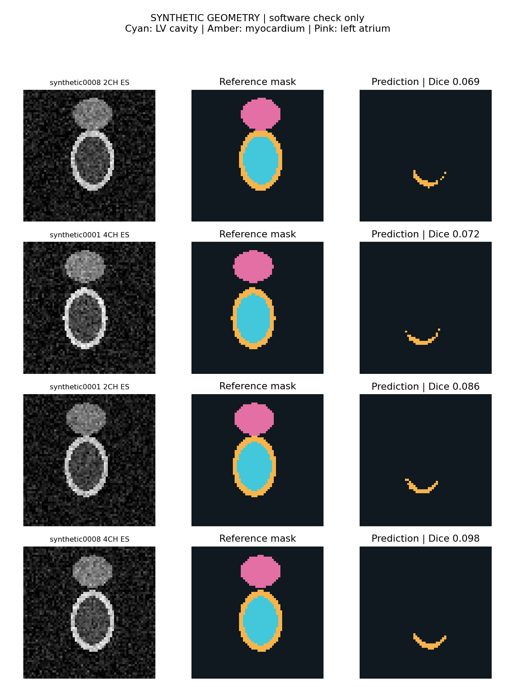

# Synthetic software-check example

These outputs come from generated geometric fixtures, **not CAMUS patients or ultrasound acquisitions**. They demonstrate the runnable evaluation pipeline and deliberately expose imperfect predictions. They do not measure medical segmentation quality.

Reproduce from the repository root in a clean environment:

```bash
python -m camus_seg.cli demo --out runs/synthetic-demo
```

The fixture generator uses seed 7; split, model initialization and training use seed 42. There are 12 synthetic IDs with four frames each, divided 8/2/2. Training uses width 4, input size 64, batch size 8, a maximum of20epochs, patience10 and learning rate0.005. This recorded run stopped at epoch19 after10 consecutive validation epochs without improvement; its best checkpoint is epoch9. Checkpoint selection uses validation Dice. The smoke report uses200 patient-bootstrap replicates; real evaluation defaults to2,000.

Files preserve the generated report, per-frame/per-patient metrics, selected checkpoint's provenance, exact split, and epoch history. Synthetic arrays and model weights are regenerated locally and are not distributed. See the report's `kind`, hash fields, subgroup sizes and surface-failure counts before interpreting any number. With only two test IDs, its confidence intervals have no useful research interpretation.

The four worst held-out fixture frames are shown below. Left: input geometry with noise. Middle: reference. Right: model prediction. The missing atrium predictions are counted as surface failures rather than assigned zero distance.


