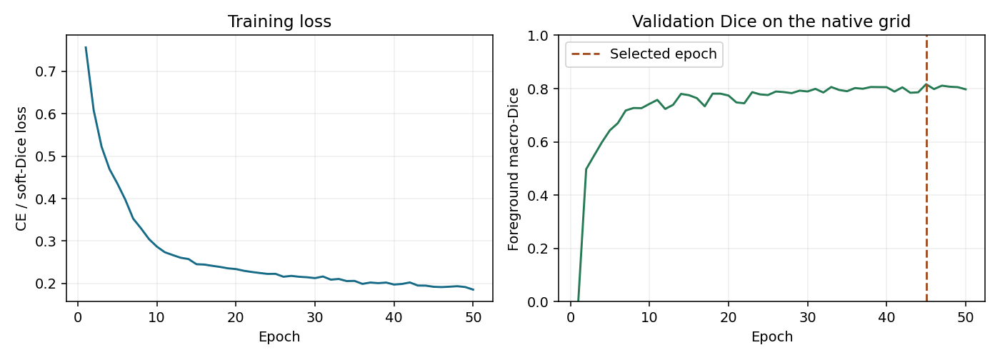
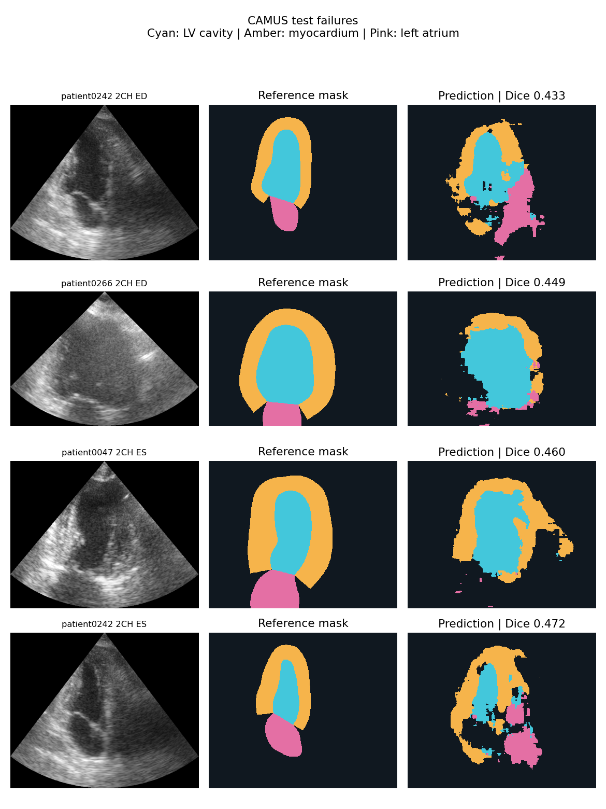

# Completed CAMUS baseline

One fixed 50-epoch cuda run, seed 42; frozen membership: 400 training / 50 validation / 50 test patients. All four annotated frames per patient remain together. The selected checkpoint was evaluated once on 50 held-out test patients (200 frames).

**Primary patient-mean foreground macro-Dice: 0.8153 [0.7953, 0.8324].** Brackets show 95% percentile patient-bootstrap confidence intervals (2,000 replicates).

| Scope | Dice | IoU | HD95 (mm) | ASSD (mm) | Empty-mask failures |
| --- | --- | --- | --- | --- | --- |
| All structures | 0.8153 [0.7953, 0.8324] | 0.7052 [0.6821, 0.7258] | 20.2216 [18.2755, 22.2469] | 4.4838 [4.0730, 4.9604] | 0 / 600 |
| lv_cavity | 0.8741 [0.8602, 0.8866] | 0.7836 [0.7635, 0.8023] | 20.5225 [18.0835, 23.0716] | 4.5377 [4.0494, 5.0570] | 0 / 200 |
| myocardium | 0.7731 [0.7535, 0.7908] | 0.6387 [0.6149, 0.6608] | 21.4077 [18.2914, 24.7064] | 3.9777 [3.5990, 4.3792] | 0 / 200 |
| left_atrium | 0.7988 [0.7622, 0.8294] | 0.6932 [0.6545, 0.7275] | 18.7346 [16.5101, 21.1395] | 4.9360 [4.2385, 5.7716] | 0 / 200 |

Distance summaries condition on defined surfaces; undefined pairs and contributing patient counts are recorded in report.json. Both-empty masks score Dice/IoU=1 and distance=0; exactly-one-empty masks score overlap=0, distance=null and an empty-mask surface failure. This counter does not count every segmentation error: fragmented masks or distant false-positive islands can have defined surfaces and large distances. Background is excluded from macro scores.

## Image quality

| Quality | Patients | Dice [95% CI] | Empty-mask failures |
| --- | --- | --- | --- |
| Good | 30 | 0.8361 [0.8095, 0.8578] | 0 |
| Medium | 26 | 0.7902 [0.7474, 0.8232] | 0 |
| Poor | 10 | 0.7974 [0.7630, 0.8273] | 0 |

Quality is recorded per view. A patient can contribute to more than one quality subgroup, so subgroup patient counts need not sum to the test-set size.

All-background reference Dice: 0.0000 [0.0000, 0.0000]. This checks metric behavior; it is not a competitive segmentation baseline.

The validation-selected checkpoint is epoch 45. Settings and environment are in provenance.json; the predeclared budget and test policy are in run-plan.json. No augmentation, pretraining, postprocessing or test-driven tuning was used.

## Failure cases

These are the four test frames with the lowest foreground macro-Dice, selected automatically. They include reference masks and model predictions.

## Interpretation and provenance

This is a single-seed, single-site research baseline. Its confidence intervals capture held-out patient sampling variation, not optimization or split uncertainty. It includes poor-quality frames and uses the corrected public NIfTI release; it is not a direct reproduction of the original paper's complete evaluation. It provides no evidence of external or clinical validation.

Code is MIT-licensed. The CAMUS-derived failure figure is an adaptation under CC BY-NC-SA 4.0, with the source's non-commercial scientific research terms retained in DATA_LICENSE.md. Frames are resized and arranged with reference/prediction panels; no raw dataset or model weights are distributed here.

Source: [official CAMUS deposit](https://humanheart-project.creatis.insa-lyon.fr/database/#collection/6373703d73e9f0047faa1bc8). Leclerc et al., *Deep Learning for Segmentation Using an Open Large-Scale Dataset in 2D Echocardiography*, IEEE TMI 38(9), 2198–2210 (2019), [doi:10.1109/TMI.2019.2900516](https://doi.org/10.1109/TMI.2019.2900516).
