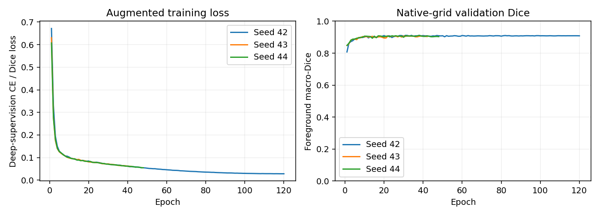
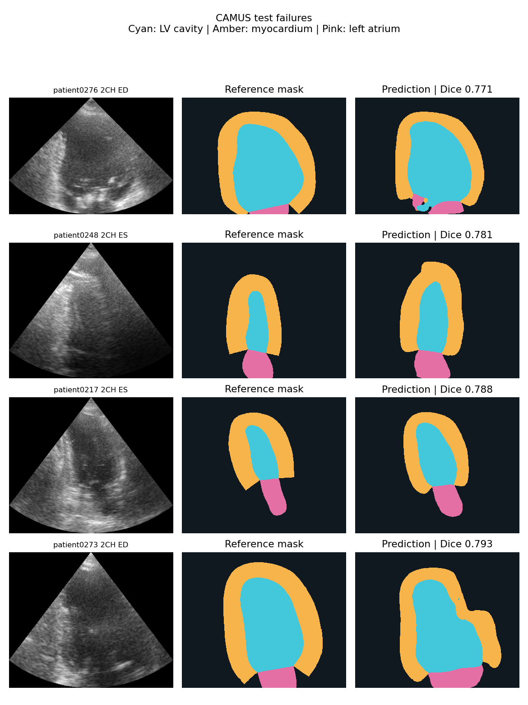

# Validation-selected CAMUS improvement

**Evaluation status: this is a development follow-up on the same 50 test patients whose baseline results and failure gallery were already inspected. It is not a fresh independent confirmation.** All new checkpoint, seed, ensemble and cleanup selection used the 50 validation patients only.

The frozen choice is **ensemble_raw**, using seed(s) [42, 43, 44], with component cleanup **False**. The original 400/50/50 patient membership is unchanged. The completed seed 42 checkpoint was reused; two new trials ran concurrently with a maximum of 120 epochs and patience 10. Actual epoch counts and stop reasons are recorded below. The selected configuration was evaluated once on all 200 test frames.

| Patient-mean metric | Original | Selected model [95% CI] | Paired change [95% CI] |
| --- | --- | --- | --- |
| Foreground macro-Dice | 0.8153 | 0.9141 [0.9071, 0.9202] | 0.0988 [0.0851, 0.1155] |
| Foreground macro-IoU | 0.7052 | 0.8456 [0.8348, 0.8552] | 0.1404 [0.1245, 0.1587] |
| HD95 (mm) | 20.2216 | 4.0553 [3.6666, 4.5555] | -16.1663 [-18.2690, -14.1716] |
| ASSD (mm) | 4.4838 | 1.4631 [1.3579, 1.5826] | -3.0207 [-3.4801, -2.6135] |

Changes are new minus original: positive overlap and negative distances indicate improvement. Intervals use 2,000 patient-paired bootstrap replicates; they preserve the shared patient identities. They reflect patient sampling variation conditional on these trained models, not fresh-test independence or uncertainty over all training seeds.

Undefined empty-mask distance pairs: 0 / 600. This is an empty-mask counter, not a count of all segmentation or anatomical errors. Conditional distance exclusions and sample counts are in report.json.

## Structures

| Structure | Original Dice | Selected Dice [95% CI] | Original HD95 | Selected HD95 |
| --- | --- | --- | --- | --- |
| lv_cavity | 0.8741 | 0.9395 [0.9335, 0.9450] | 20.5225 [18.0835, 23.0716] | 3.7496 [3.3747, 4.1718] |
| myocardium | 0.7731 | 0.8806 [0.8693, 0.8898] | 21.4077 [18.2914, 24.7064] | 4.1411 [3.7275, 4.7211] |
| left_atrium | 0.7988 | 0.9223 [0.9131, 0.9306] | 18.7346 [16.5101, 21.1395] | 4.2753 [3.6345, 5.0380] |

## Complete validation selection

| Candidate | Dice | HD95 (mm) | Empty-mask failures | Decision |
| --- | --- | --- | --- | --- |
| ensemble_raw | 0.9170 | 3.7180 | 0 | Selected |
| ensemble_lcc | 0.9159 | 3.7382 | 0 |  |
| seed44_lcc | 0.9118 | 3.9281 | 0 |  |
| seed42_raw | 0.9115 | 3.9439 | 0 |  |
| seed44_raw | 0.9110 | 4.1391 | 0 |  |
| seed42_lcc | 0.9107 | 3.9708 | 0 |  |
| seed43_raw | 0.9081 | 4.3400 | 0 |  |
| seed43_lcc | 0.9070 | 4.2385 | 0 |  |

Each seed's checkpoint was selected by highest native-grid validation Dice. Among the 8 fixed inference candidates, configurations within 0.001 of the highest validation Dice were ranked by fewer empty-mask distance failures, lower mean HD95, fewer ensemble members, then lexical ID. No policy was chosen using the new test scores.

## Training and model

The model has four downsamplings (five levels), base width 16, instance normalization, LeakyReLU and transposed-convolution upsampling. Inputs use aspect-preserving 256-square letterboxing. Auxiliary decoder losses use nearest-downsampled labels at four scales, with normalized weights 1, 0.5, 0.25 and 0.125. All distances are scored after native-grid restoration.

The already completed seed 42 model was retained. New seeds 43 and 44 used up to 120 epochs, with immediate termination after 10 consecutive validation epochs without a strict Dice improvement. Batch size 16, AdamW at 0.001 with weight decay 0.0001, cosine scheduling to 0.00001, gradient norm clipping at 5, and mixed-precision CUDA were used. Paired affine augmentation uses +/-10-degree rotation, scale 0.9–1.1 and +/-8% translation; no mirroring. Losses are evaluated in float32. Strict deterministic algorithms remain enabled. The two new CUDA jobs share one prepared CPU tensor cache; data preparation and independent validation metric calculations use up to 20 CPU threads.

| Seed | Actual epochs | Selected epoch | Best raw validation Dice | Parameters | Stop reason | Used |
| --- | --- | --- | --- | --- | --- | --- |
| 42 | 120 | 34 | 0.9115 | 1,943,248 | completed_before_user_policy_change | True |
| 43 | 42 | 32 | 0.9081 | 1,943,248 | validation_patience | True |
| 44 | 48 | 38 | 0.9110 | 1,943,248 | validation_patience | True |

## Image quality

| Quality | Contributing patients | Selected Dice [95% CI] |
| --- | --- | --- |
| Good | 30 | 0.9231 [0.9171, 0.9287] |
| Medium | 26 | 0.9109 [0.8997, 0.9208] |
| Poor | 10 | 0.8890 [0.8654, 0.9087] |

Quality is per view, so a patient may contribute to multiple subgroups. These descriptive groups overlap and their counts need not sum to 50.

## Remaining failure cases

The four lowest foreground macro-Dice frames for the selected model are shown automatically. All qualities and all test patients remain included.

## Scope and attribution

This comparison evaluates a bundled training/inference recipe; it does not isolate the causal contribution of each architectural or training change. There is no claim of state-of-the-art performance, external validation or clinical suitability. The original baseline and its immutable records are preserved in ../camus-seed42/. The version 2 scheduler was cancelled at the user's runtime-policy change: seed 42 had completed 120 epochs and seed 43 had run one epoch. That partial seed 43 attempt is excluded; its replacement and seed 44 are the new early-stopped trials. Mixed training-source versions are intentional for the reused checkpoint and are recorded per member. Checkpoint, source, split and plan fingerprints are retained, along with every validation candidate and all three training histories.

Training choices were informed by [Kjelsrud et al., Lightweight image segmentation for echocardiography](https://arxiv.org/abs/2509.03631); this implementation and its evaluation are not a replication of that study.

Code is MIT. CAMUS-derived failure figures retain CC BY-NC-SA 4.0 and the source's non-commercial scientific research terms in DATA_LICENSE.md. Frames are arranged with manual-reference and model-prediction panels. Source: [official CAMUS deposit](https://humanheart-project.creatis.insa-lyon.fr/database/#collection/6373703d73e9f0047faa1bc8). Leclerc et al., IEEE TMI 38(9), 2198–2210 (2019), [doi:10.1109/TMI.2019.2900516](https://doi.org/10.1109/TMI.2019.2900516). Raw data and weights remain local and are not redistributed here.
